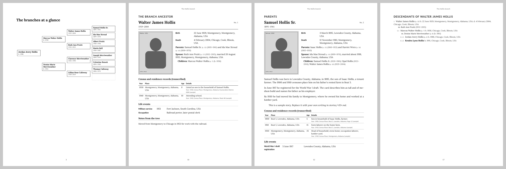

# gedbook: a family history book from your GEDCOM

gedbook reads the GEDCOM file exported from your family tree, matches your folder of photos to the people in it, and drafts a print-ready family history book as a PDF.

I built it while writing a two-volume history of my own family from a tree of about 8,000 people and 1,700 images. Laying out hundreds of pages by hand was not workable, so the pages are generated from the tree and the writing goes in on top. This repository is that pipeline rewritten so anyone can run it on their own tree.

**What to expect.** gedbook does its best to match photos, census entries, and records to the right people, and it gets many of them right on the first pass. It will also make mistakes, especially with people who share a name (a father and son, two cousins named for the same grandparent). Every match lands in a spreadsheet for you to check, and the first PDF is a working draft. Plan to review, correct, write, and rebuild several times.

## Demo



The sample book is built from `examples/sample_family.ged`, a fictional family. Every name, date, and record in it is invented.

What the book contains:

- A title page, a "How to use this book" page with a standards-of-evidence statement, a pedigree chart of the branches, and a table of contents with page numbers.
- **The present generations:** you, your parents, and your grandparents, depending on where the branches start.
- **One part per branch**, each anchored on one of your ancestors (grandparents for 4 branches, great-grandparents for 8). Each branch has a pedigree chart, a full entry for every direct ancestor, and a numbered list of the branch ancestor's descendants.
- **Full entries** show the photo, vital facts, parents, spouses, children with page references, a transcribed table of census and residence records, other life events, notes from the tree, extra images (headstones, documents), sources cited, and your own story if you wrote one.
- **Research frontier:** direct ancestors whose parents are not yet known, and surname clusters in your tree that do not connect to you (often research pools gathered while chasing a brick wall).
- **Index of names** with page numbers.

In a draft build, shaded boxes give writing prompts tied to the history each person lived through (for example Reconstruction, the Great Migration, or the 1918 influenza pandemic, depending on dates and places), and unconfirmed photos carry a flag. A `--final` build removes both.

## Hardware required

Any Windows, macOS, or Linux computer. A tree of 8,000 people with 1,000 images builds in a few minutes and needs about 2 GB of free memory.

## Software required

| Software | Version tested | Notes |
| --- | --- | --- |
| Python | 3.11 or later (tested on 3.13) | |
| WeasyPrint | 70.0 | Makes the PDF. Needs the Pango library on your system (see Installation). |
| Jinja2 | 3.1.6 | Page templates |
| Pillow | 12.3.0 | Reads image metadata and prepares images for print |
| RapidFuzz | 3.14.6 | Fuzzy name matching |

Your family tree program only needs to export GEDCOM 5.5 or 5.5.1. Ancestry, FamilySearch, MyHeritage, RootsMagic, Family Tree Maker, Legacy, and Gramps all do.

## Installation

1. Get the code.

   ```
   git clone https://github.com/reijinarudo/gedbook.git
   cd gedbook
   ```

2. Create a virtual environment and install.

   ```
   python -m venv .venv
   .venv\Scripts\activate          (Windows)
   source .venv/bin/activate       (macOS and Linux)
   pip install -e .
   ```

3. Install Pango for WeasyPrint.

   - **macOS:** `brew install pango`
   - **Debian or Ubuntu:** `sudo apt install libpango-1.0-0 libpangoft2-1.0-0`
   - **Windows:** follow the WeasyPrint instructions for installing Pango through MSYS2: https://doc.courtbouillon.org/weasyprint/stable/first_steps.html#windows

   If this step gives you trouble, add `--no-pdf` to the build command. You still get `book.html` and the photo match sheet while you sort out the PDF step.

4. Optional: download the Lora and Carlito fonts into `fonts/` (see `fonts/README.md`).

5. Check the install with the sample family:

   ```
   gedbook build examples/sample_family.ged --root I1 --media examples/media --stories examples/stories --out sample_book
   ```

   Open `sample_book/book.pdf`.

## Configuration

No accounts or API keys are needed. Everything runs on your computer and nothing is uploaded.

Settings can come from three places. The command line wins, then `gedbook.toml`, then `.env`:

- Copy `config.example.toml` to `gedbook.toml` and fill it in. Each setting has a comment.
- Or copy `.env.example` to `.env` for the four basic paths.

Both `gedbook.toml` and `.env` are ignored by git, so your file paths stay private.

Main settings:

| Setting | Default | Meaning |
| --- | --- | --- |
| `root` | (required) | ID of the person the book is built around, usually you |
| `branch_generation` | 2 | 1 = a branch per parent, 2 = per grandparent, 3 = per great-grandparent |
| `descendant_depth` | 4 | Generations of descendants listed in each branch |
| `living` | `year-only` | People who may be living: `full`, `year-only` (dates cut to the year), `private` (name only), `hidden` (shown as "Living" plus surname) |
| `living_years` | 100 | No death recorded and born within this many years counts as possibly living |
| `color` | false | Photos print in grayscale unless set |
| `final` | false | Removes writing prompts and review flags |

The page size is 8.25 x 11 inches with a binding gutter, a common hardcover trim on print-on-demand services. Change it at the top of `gedbook/templates/book.css`.

## Usage

**1. Look at your tree and find your ID.**

```
gedbook stats my_tree.ged
gedbook find my_tree.ged "Jordan Hollis"
gedbook stats my_tree.ged --root I1 --branch-generation 3
```

The last command prints the branches, how many full entries and list entries the book will have, and a rough page count. Try generations 1, 2, and 3 to pick the book's shape.

**2. Match your photos.**

```
gedbook match my_tree.ged photos/ -o media_matches.csv
```

gedbook looks at four things for each image:

1. A file name that your GEDCOM links to the person.
2. Names written into the image's own metadata: the caption or title, tags, and face-tag names saved by Windows Photos, Lightroom, Picasa, digiKam, and similar programs.
3. Media titles in the GEDCOM (Ancestry exports carry titles but no file names).
4. Names in the file name, such as `mary_ellen_hollis_1921.jpg`. Years in the name are checked against each candidate's lifespan, and Sr./Jr. are used when present. Married surnames count.

It skips thumbnails and exact duplicates. Each image gets a status:

| Status | Meaning | What you do |
| --- | --- | --- |
| AUTO | One clear match | Spot-check. Type `no` in `confirm` to reject. |
| REVIEW | Likely match, or two people with similar names | Type `yes` in `confirm`, or put the right ID in `override_person_id` |
| UNMATCHED | No name found | Put an ID in `override_person_id`, or leave it |
| DUPLICATE, THUMBNAIL | Skipped | Nothing |

Other columns you can edit: `use` (`no` keeps an image out of the book), `kind` (`portrait` becomes the main photo; `headstone`, `obituary`, `certificate`, `letter`, `group` go in the gallery), and `caption`.

Images with "census" in the name are set to `use = no`. Census pages downloaded from subscription sites may carry reuse restrictions, so the book prints the census facts as a transcribed table.

Renaming files helps more than anything else. `samuel_hollis_sr_1940.jpg` and `ruth_pruitt_hollis_headstone.jpg` match far better than `IMG_4471.jpg`. gedbook reads JPG, PNG, TIFF, GIF, WebP, and BMP files; convert PDFs of documents to images if you want them in the book.

**3. Build the draft.**

```
gedbook build my_tree.ged --root I1 --media photos/ --matches media_matches.csv --title "The Hollis Family" --author "Your Name"
```

Output goes to `book_output/`: `book.pdf`, `book.html` (for a quick look in a browser), and the prepared images.

**4. Write.** Add Markdown files to `stories/`, named by person ID (`I9.md`), branch (`branch-I5.md`), or `introduction.md`. See `stories/README.md`. Rebuild to see them in place.

**5. Fix the tree, then rebuild.** When something in the book is wrong, correct it in your tree program, export a fresh GEDCOM, and rebuild. Corrections made in the tree carry into every later build.

**6. Final build.** Add `--final` when you are ready to print.

### Using an AI assistant

`CLAUDE.md` holds instructions for Claude and other coding assistants: the step-by-step workflow, rules for writing stories only from documented facts with evidence labels, and privacy rules. Open this folder in Claude Code or Claude Cowork and say "Read CLAUDE.md and help me build my family book." See `docs/using-with-claude.md` for prompts that work, and `docs/research-protocol.md` for a research checklist you can hand an assistant before searching record sites.

## Privacy

Family trees hold information about living people. Before you share a PDF or push anything to a public repository:

- Keep the default `living = "year-only"` or choose `private` or `hidden`. Detection is cautious: a person with no recorded death and no usable dates is treated as living.
- Never commit your GEDCOM, photos, DNA files, or interview recordings. The `.gitignore` covers common names; check `git status` before every commit.

## Project layout

```
gedbook/
  gedbook/
    cli.py           commands: stats, find, match, build
    gedcom.py        GEDCOM reader (no outside dependencies)
    dates.py         GEDCOM date phrases: sorting and display
    privacy.py       living-person detection and display rules
    selection.py     branches, ancestor numbering, descendants, research frontier
    media.py         photo matching and the review sheet
    eras.py          historical prompts for draft builds (edit for your family's places)
    render.py        builds the pages and writes HTML and PDF
    templates/       book.html.j2 and book.css (layout, fonts, page size)
  examples/          fictional sample tree, images, and stories
  stories/           your writing (ignored by git)
  fonts/             optional font files (ignored by git)
  docs/              screenshots, AI assistant guide, research protocol
  tests/             pytest suite (run: pip install -e .[test]; pytest)
  CLAUDE.md          instructions for AI assistants
  config.example.toml, .env.example
```

## Known limits

- GEDCOM 7 files are not tested. Export as 5.5.1 if your program offers it.
- ANSEL-encoded files are read as Latin-1, so a few accented letters may print wrong. Export as UTF-8.
- Each person gets one entry; when two branches share an ancestor, the second branch links to the first entry.
- Face recognition is not included. Photos are matched by names in file names, metadata, and the GEDCOM.
- The writing prompts in `eras.py` cover broad United States history. Add entries for the regions and countries in your tree.

## Credits

gedbook is my own code. It depends on these open-source projects, used under their licenses and not modified:

| Project | Author | License | Link |
| --- | --- | --- | --- |
| WeasyPrint | CourtBouillon and contributors | BSD-3-Clause | https://github.com/Kozea/WeasyPrint |
| Jinja2 | Pallets | BSD-3-Clause | https://github.com/pallets/jinja |
| Pillow | Jeffrey A. Clark and contributors | MIT-CMU | https://github.com/python-pillow/Pillow |
| RapidFuzz | Max Bachmann | MIT | https://github.com/rapidfuzz/RapidFuzz |
| Lora typeface (optional download) | Cyreal | SIL Open Font License 1.1 | https://github.com/cyrealtype/Lora-Cyrillic |
| Carlito typeface (optional download) | Łukasz Dziedzic (tyPoland) | SIL Open Font License 1.1 | https://github.com/googlefonts/carlito |

The GEDCOM format is published by FamilySearch (The Church of Jesus Christ of Latter-day Saints): https://gedcom.io

The code was developed with AI assistance (Claude, by Anthropic). Design decisions, the book structure, the evidence standards, and testing against a real family archive are mine.

## Modifications and design decisions

These come from building my own family's book and are the parts I would point a reviewer to:

- **Branch-based organization.** The book is divided by ancestor at a chosen generation, with full entries for direct ancestors and short register entries for collateral relatives. This keeps an 8,000-person tree to a printable size while still letting each cousin line find itself.
- **Tiered depth.** Direct ancestors get full pages; descendants and spouses get one-line entries; people who do not connect to the root are summarized as research leads in the back matter.
- **Photo matching built for real family archives.** It handles Ancestry exports that carry media titles without file names, Windows and Lightroom face tags, married surnames, Sr./Jr. pairs, years that rule a candidate in or out, thumbnails, and duplicate copies. Matches are written to a sheet a person reviews; the program never treats its own guess as final.
- **Census facts transcribed as text.** Census and residence facts are printed as text tables, and census images default to excluded, because record images from subscription services can carry reuse restrictions.
- **Living-person protection by default,** with four levels, and a cautious rule that treats undated people as living.
- **Standards of evidence in the book itself.** The front matter explains what counts as documented, and the AI assistant instructions require evidence labels (documented, family report, inferred, under review) on every claim in written stories.
- **Historical-context prompts** that point the writer to records and events of each person's era and place, shown only in drafts.
- **A workflow for AI-assisted research,** with a protocol that requires three independent anchors for any record match.

## License

MIT for my code (see `LICENSE`). Each dependency keeps its own license, listed under Credits.

## Contact

Dr. Reginald Finley: contact@drreginaldfinley.com, https://drreginaldfinley.com
